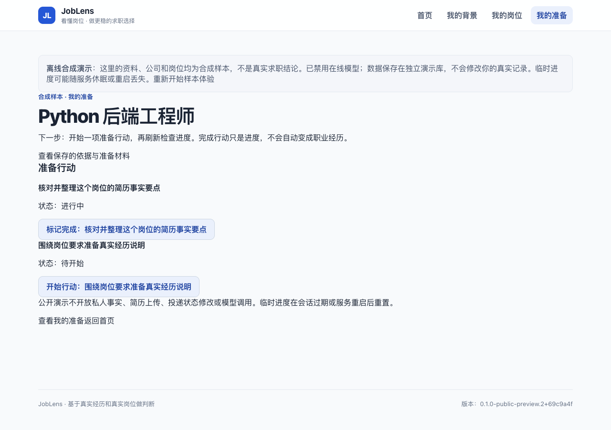

# JobLens Agent

**把真实职业经历和真实岗位放在一起，帮你决定先投入哪里，以及下一步准备什么。**

JobLens 不用一个“匹配概率”替你做决定。它区分已有证据、关键未知、准备差距和明确硬冲突；证据不足不会冒充满足，没有可靠建议也不会硬凑 Top 3。

[](https://github.com/peewee92/JobLens-Agent/actions/workflows/ci.yml)
[](LICENSE)

**[在线体验：三个岗位，先准备哪个？](https://joblens-agent.vercel.app/demo)** · [操作录屏与预发布版本](https://github.com/peewee92/JobLens-Agent/releases/tag/v0.1.0-public-preview.2)



*实际运行截图，使用公开合成样本；不是生成的界面设计图或真实求职结论。*

## 公开演示交付状态

**已发布 Vercel＋Render 免费合成演示**，不需要登录或私人简历，不调用在线模型。已验证比较 → 确认 → 建立工作区 → 开始行动 → 刷新保留。免费后端会休眠，唤醒失败时请稍后手动重试；进度在会话到期或重启后重置。

访问验证使用本机已有代理；**尚未通过两个国内普通网络验收，不承诺国内直连稳定**。真实模型小样本提取报告与在线演示分开，[查看五个岗位的真实模型结果与失败点](docs/release/REAL-MODEL-RESULTS.md)。录屏约 39 秒，无配音，不是完整三分钟介绍视频。

- [免费部署与回滚步骤](docs/release/DEPLOY.md)：Vercel 网页＋Render 单进程后端，独立临时合成会话，禁止在线模型与私人上传。
- [真实模型与用户验收](docs/release/QUALITY-AND-USER-STUDY.md)：真实效果与合成演示分开；三人试用仍待执行。
- [一页架构与 Agent 边界](docs/architecture/PUBLIC-PROJECT-EVIDENCE.md)：围绕证据、恢复与行动解释设计，不以框架数量证明价值。
- [本轮交付证据](docs/release/STATUS.md)：已验证、未核实与账户依赖分别记录。

## 先体验：本地零模型演示

需要 Python 3.12+、uv、Node.js 20.9+ 和 pnpm 10.33.2。首次在仓库根目录安装依赖，再启动：

```bash
(cd services/backend && uv sync)
(cd apps/web && pnpm install --frozen-lockfile)
python3 scripts/demo.py
```

以后只需最后一条命令。打开终端显示的网址，默认是 `http://127.0.0.1:3100`。

- 自动建立独立演示库，准备合成资料与三个样本岗位，启动前后端。
- 不读取你的真实数据库，子进程密钥置空，在线模型和备用模型均禁用。
- 只监听本机，不需要登录；这是本地单用户作品，不是公开部署的多用户服务。
- 不自动投递，不发送招聘消息。预置样本不代表真实模型质量。

### 三分钟可以看到什么

1. **比较岗位**：首页 → 选择岗位 → 检查所选岗位 → 运行分析。Python 岗位有证据支持；TypeScript 岗位证据不足；至少 5 年经验的岗位与样本资料的 2 年经验明确冲突。
2. **看依据并确认目标**：打开各岗位的证据与未知，确认值得投入的目标；最多建议 3 个、人工最多确认 5 个，允许没有推荐。
3. **开始准备**：打开保存的分析与材料 → 开始执行 → 进入岗位工作区 → 开始一项行动。刷新后，材料和行动进度仍保留。

想看反馈闭环：完成“围绕岗位要求准备真实经历说明”行动，提交支持 Docker 要求的**合成成果**并人工确认，再更新原目标。可以看到证据覆盖改善但名次不变；旧分析仍可打开。不要为了演示把虚构成果当成真实职业事实。

想看故障恢复：在目标待确认时 `Ctrl+C` 停止服务，用终端打印的恢复命令启动同一目录，重新打开原运行继续。刷新只查看状态，不自动重算。

### 启动、恢复与常见问题

| 情况 | 怎么做 |
| --- | --- |
| 从空白流程开始 | `python3 scripts/demo.py --empty`；仍是离线演示环境，不是任意真实 JD 的完整提取器 |
| 端口被占用 | 添加 `--backend-port 8101 --web-port 3101`，打开终端打印的新网址；脚本不会停止其他服务 |
| 退出后恢复 | 使用终端打印的原目录恢复命令；退出保留数据，再次不带目录启动会创建新演示 |
| 未完成初始化或未知非空目录 | 保留原目录，不要清理真实记录；不指定 `--directory` 可创建新的演示 |
| 依赖缺失 | 按命令提示完成首次安装；脚本不会代替你安装依赖 |

## 用自己的资料和岗位

**演示与真实使用分开。** 演示目录的数据可保留，但它使用离线样本提取，不应拿来证明真实岗位已完整解析。

真实使用先按[后端说明](services/backend/README.md)设置私有数据库和模型，再按[网页说明](apps/web/README.md)连接前后端。默认模型禁用；无配置或未授权时，界面应明确阻断，不伪报成功。新岗位提取和必要的语义匹配需要逐次授权；排序、差距、准备及人工确认不新增模型调用。

**匹配全部为 0 时：**新版报告会分别展示已有支持、部分支持、证据未覆盖、待核实和明确硬冲突。检索规则更新后，旧报告仍保留，但需在岗位详情显式重新生成匹配；仍有效的岗位要求不必再次提取。候选经历不等于满足要求，授权后才进行必要的语义判断。见[本轮修复与验证记录](docs/implementation/Evidence-Recall-v2-Delivery.md)。

已有数据库先按[副本迁移步骤](services/backend/README.md#先检查就绪再验证副本)验证，不要直接升级唯一原库。迁移成功只说明数据可读，不代表旧分析仍然有效。

真实主流程：

```text
确认职业资料与求职意向 → 粘贴 JD 或导入采集岗位 → 核对岗位要求
→ 查看匹配依据、未知与冲突 → 比较岗位并确认目标
→ 保存准备材料 → 一键创建工作区与行动
→ 人工记录结果／提交新事实 → 确认事实后更新原范围，保留历史
```

- **报告缺失或过期**：选择原岗位并检查 → “按当前事实分析这批岗位” → 先预检，再明确启动。一次最多选择 50 个岗位，每次最多新增分析 5 个，单个失败保留其他成功结果。
- **证据不足**：核对要求与现有事实，允许查看准备方向；没有技能记录不等于不会，没有学历证据不等于学历不达标。
- **只有挑战岗位**：明确展示关键未知，不包装成高度匹配。明确硬冲突必须引用已确认事实／偏好和岗位条件。
- **行动完成**：只改变行动状态，不自动升级能力。新经历或成果必须另行确认；更新后排名不一定上升。

职业资料、简历、数据库、原始私有数据和密钥留在本地，不提交到公开仓库。真实数据截图和演示视频也应先脱敏。

## 当前验证到哪里

| 范围 | 已有证据 | 不能据此声称 |
| --- | --- | --- |
| 合成主流程 | 空库连续浏览器流程：手工资料与三个岗位、要求核对、三种结论、重启恢复、行动、事实确认及再次分析 | 非开发者已从头完成全流程，或真实模型效果已达标 |
| 真实历史数据 | 独立副本迁移与只读接口检查；三个历史岗位的零模型重算、确认及工作区页面路径 | 新真实 JD 提取或当前模型质量已验收 |
| 恢复与数据保护 | 并发确认、相同请求重放、事务失败回滚；演示进程重启和页面刷新验证 | 外部模型调用绝对不会重复或永不失败 |
| 对外展示 | 本地单命令演示；已录制约三分钟连续合成数据演示，见下方文件 | 已完成真实用户试用、真实模型质量验收或生产部署 |

**演示文件：**连续操作视频（179.8 秒，无配音，合成数据；尚未公开发布，因此暂不提供下载链接）。已检查画面、时长及编码；只有空间裁剪和转码，没有时间剪辑。文件保存在本地工作区，尚未上传或发布。

**最新进展（2026-11-02）：**在独立私有验收库中，五个真实岗位提取请求均返回 HTTP 200，实际 5 次调用，保存 52 条结构化要求。标准价合计估算约 0.0189 元，实际账单未核对；发现原文截断仍被保留为要求的问题，不能将接口成功当作完整质量通过。尚未完成严格标注评估或语义匹配对比。见[真实模型结果](docs/release/REAL-MODEL-RESULTS.md)。原岗位、模型输出与用量凭据仅保存在被忽略的私有目录。

**仍待完成：**非开发者试用、少量新真实岗位模型质量验收。以下为此前阻塞历史：2026-10-31 已获本轮 5 元上限授权，首个真实岗位提取请求被已配置网关以 HTTP 402 拒绝；实际尝试 1 次，没有可用要求或匹配结果，后续调用已停止。用量和实际费用未知，不能记为零或质量通过。需先解决模型服务账户／计费条件。最多五个岗位、两轮针对性修正，不进入无限质量门循环。最新顺序与逐轮证据见[路线图顶部](docs/roadmap/ROADMAP.md)；本地工作区验证不等同于远端 CI 已通过。

<details>
<summary>给试用者的任务卡与三分钟录制顺序</summary>

由维护者启动上面的合成演示，把浏览器交给不熟悉项目的人；不先解释操作，不要求输入私人资料。

- **先看 90 秒**：用自己的话说出它解决什么问题、不会替你做什么、现在该点哪里。答不出就记录原话，不当场教答案。
- **完成一个任务**：找出最值得先投入的样本岗位，解释另两个为什么暂不优先；确认目标，进入工作区并开始一项行动，再刷新。
- **只记录事实**：卡住的页面／按钮、预期发生什么、实际发生什么、是否需要维护者帮助。不要只记录“感觉不错”。
- **录制顺序**：0:00–0:20 说明合成数据与产品问题；0:20–1:20 比较支持、未知与硬冲突；1:20–2:20 确认目标并保存材料、建立工作区；2:20–3:00 开始行动并刷新，展示进度保留。遇到错误保留在录像中，不剪掉。

独立用户试用仍待执行，上方视频是维护者操作记录，不是用户试用通过记录。三分钟视频只演示核心决策与行动，不声称涵盖从空库输入、事实反馈、模型质量或所有故障恢复。试用反馈回来后，只优先修阻止任务完成、误解结论或丢失状态的问题；没有实际卡点不新增功能。

</details>

## 架构与工程证据

```text
网页工作台 / 辅助自然语言
          ↓
FastAPI 单体应用服务 → 已有提取、匹配、差距与准备工作流
          ↓
LangGraph 排序编排 + 应用层持久运行、人工确认和恢复
          ↓
SQLite：版本化事实、匹配报告、保存分析、工作区与行动
```

- **证据优先**：匹配、差距和准备共用结构化岗位要求，不能重新读 JD 随意编造事实；数值分数不是概率。
- **有意保留混合架构**：使用真实 LangGraph `StateGraph` 排序；人工确认、恢复和检查点由应用层实现。没有把原生 `interrupt()` / `Command(resume=...)` 当成已使用能力。
- **短事务与副作用分开**：固定事实版本，调用模型时不持有数据库事务；保存结果和完成状态原子提交，调用尝试与不确定结果单独记录。
- **协议不重写业务**：MCP 使用官方 Python SDK，通过 STDIO 暴露已有只读工具；不另建编排或写入路径。自由对话与工具循环不是主产品操作的必经入口。
- **简单部署边界**：本地单用户、一个后端进程、SQLite；不为展示增加微服务、多 Agent、任务队列或自动投递。

从这些可运行证据开始，而不是先读历史文档：

| 想追问什么 | 直接看哪里 |
| --- | --- |
| 三个岗位如何走到行动 | [联合路径测试](services/backend/tests/test_three_job_journey.py) |
| 缺失／过期报告如何安全重算 | [初次范围运行](services/backend/tests/test_initial_scope_run.py)、[网页请求重放](apps/web/tests/initial-scope-command.test.ts) |
| 行动为什么不能自动成为经历 | [事实反馈联合路径](services/backend/tests/test_action_feedback_journey.py) |
| 并发、重启和保存失败 | [持久运行测试](services/backend/tests/test_career_agent_primary_store.py) |
| 模型授权、超时与未知结果 | [语义调用边界](services/backend/app/application/semantic_match)、[岗位要求工作流](services/backend/app/application/job_requirements) |
| 演示是否真的隔离原库 | [启动脚本](scripts/demo.py)、[隔离演示测试](services/backend/tests/test_product_demo.py) |
| MCP 是协议还是第二套业务 | [协议测试](services/backend/tests/test_mcp_server_protocol.py) |

本地验证示例（只用测试隔离数据，不调用收费模型）：

```bash
(cd services/backend && .venv/bin/python -m pytest tests/test_product_demo.py tests/test_three_job_journey.py tests/test_action_feedback_journey.py -q)
(cd apps/web && pnpm test && pnpm typecheck && pnpm build)
```

## 目录与深入阅读

- `apps/web`：任务工作台；`apps/collector-extension`：只采集岗位。
- `services/backend`：应用服务、业务工作流、Agent 运行及持久化。
- `packages/contracts`：共享契约；`docs`：产品、实现与历史决策。
- [当前路线与验证边界](docs/roadmap/ROADMAP.md) · [后端启动与数据库迁移](services/backend/README.md) · [网页启动](apps/web/README.md)
- [MCP 接入说明](docs/architecture/PROJECT-REFERENCE-ARCHIVE.md#local-mcp-server-vnext-13-transport-proof) · [面试练习](docs/interview-labs.md) · [原 README 完整技术参考归档](docs/architecture/PROJECT-REFERENCE-ARCHIVE.md)

## License

[MIT](LICENSE)
