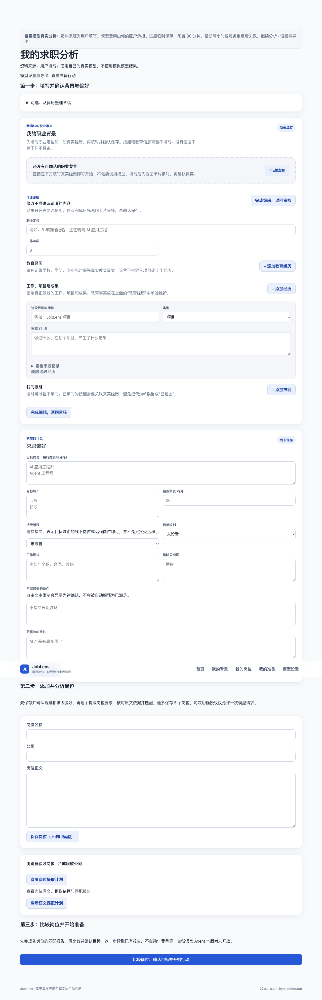

# 自带模型首版验收（2026-11-03）

## 已实现

- 快速样本与真实模式隔离；真实模式可选择空白或合成输入，合成输入不携带固定提取/匹配结果。
- 会话级连接与任务模型覆盖、接口类型及可选思考模式；仅服务器内存持有密钥。
- 背景提取只生成草稿，人工保存成为事实；岗位提取、要求确认、规则/语义匹配、排序、目标确认与准备行动复用现有主线。
- 每次付费操作显式授权，单计划一次请求；同会话单并发，全局双并发；不重试、不切换模型、不使用开发者密钥。
- 公共 HTTPS 目标在实际连接时解析、校验并固定公网 IP；保留原主机 TLS 校验，无代理环境继承和跳转。
- 当前资料和结果导出不含连接凭证；会话过期清理，重启失效；服务端开关默认关闭。

## 本地验证

- 后端全量回归：1848 项通过（在新增最后三项测试之前的全量运行）。
- 最终针对性回归：71 项通过，包含公开样本、真实模式、授权提取、授权语义匹配。
- 前端原有 323 项测试通过；类型检查和生产构建通过。
- 浏览器真实操作：创建空白会话、保存连接后输入框清空、添加岗位、刷新保留、无文件上传、无密钥导出、其他访客不能读取。该浏览器路径不发送模型请求。
- 五访客模拟并发：两个可执行、三个明确繁忙，无后台排队。
- 失败例证：客户端切换会话后，旧顶栏曾保留样本说明；改为会话创建成功后完整刷新，浏览器复验通过。

## 限额真实调用

使用用户已确认可用的北京阿里云接口和 `qwen3.8-flash`，`chat_completions`，显式关闭思考模式。输入为本轮合成验收文本，不冒充真实岗位质量评测或人工标注结果。

| 任务 | 实际请求 | 结果 |
| --- | ---: | --- |
| 连接测试 | 1 | 完成 |
| 背景提取 | 1 | 完成，未自动确认职业事实 |
| 岗位提取 | 2 | 完成 |
| 语义匹配 | 1 | 完成 |

合计输入 3497 Token、输出 824 Token；按已核对的北京标准单价估算 **0.0050224 元**，实际账单未知。本轮保守预留 **0.7 元**，计入此前 20 元总预算。没有自动重试或使用未记录的付费调用。

价格来源：[官方模型页](https://help.aliyun.com/zh/model-studio/qwen3-8-flash)。私有凭证、原始收据及调用目录不进入仓库。

## 尚未完成或不能据此声称

- 尚不支持直接编辑已保存的岗位提取事实；有误时不要确认，应重新提取。
- 没有一键自动付费批处理；每个计划为单岗位单请求，最多五个岗位。
- 自然语言 Agent 是下一切片，本版只提供显式流程。
- 未实测其他服务或模型，不能笼统声称兼容所有 OpenAI 兼容服务。
- 线上发布、免费规格资源验证与国内网络可用性必须另记实际证据，以上本地结果不替代线上结果。

## 线上发布与复验

- 入口：[连接我的模型](https://joblens-agent.vercel.app/connect)，保留 [免配置样本](https://joblens-agent.vercel.app/demo)。
- 网页部署：`dpl_3JDAVWusfGAJLZi1Cn4D6mHvAXVU`，网页代码 `e55c38c`；后端代码 `0fecfc9`，已开启自带模型开关，Render 部署 `dep-dbklbqui0phs73ak15m0` 已进入 live。
- 代码提交 `0fecfc9` 的[远端持续集成](https://github.com/peewee92/JobLens-Agent/actions/runs/41572005074)：后端 **1852 项**、前端 **323 项**、类型检查和生产构建全部通过。
- 在真实 Vercel 入口操作浏览器：创建空白会话、保存配置后密钥输入清空、添加岗位、刷新保留、无文件上传、无密钥导出、另一个访客无法访问，全部通过。
- Render 在本轮部署与并发检查期间的分钟采样内存约 **127–157 MiB / 512 MiB**；这是采样结果，不代表捕获瞬时峰值。
- 真实 Render 免费实例：两个自带模型会话的模型名称和岗位互相隔离，未确认的模型请求被拒绝，上传和自然语言 Agent 接口被拒绝。
- 开启前、开启后各进行一轮五访客并行样本完整主线，均完成目标确认和行动开始；开启后耗时约 28–31 秒（包含当前网络往返），没有模型请求。
- 当前线上验收使用合成资料与假密钥，仅验证公开入口、隔离和零费用路径。前述五次真实模型验证在独立本地环境完成，不冒充线上真实模型已验收。
- 浏览器与接口检查使用现有系统代理；未完成两个独立国内网络验证，不宣称国内网络普遍可达。
- 发布后文档更新不改变上述部署代码。原工作分支及其未提交修改保持不变。

线上界面截图：
